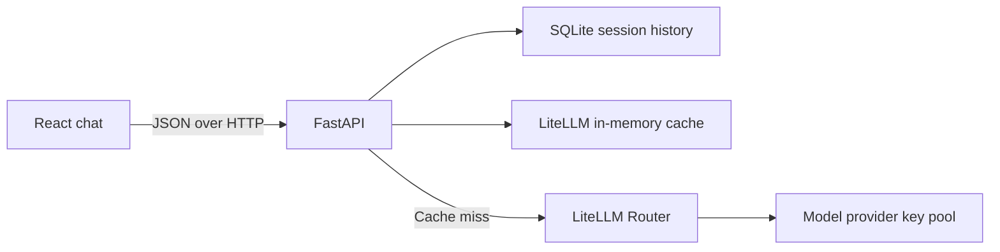

# Milo Chat

Milo is a multi-turn chatbot built for the Lyftr AI Full-Stack Assignment. It keeps conversation context in SQLite and uses LiteLLM to cache responses and switch API keys when providers fail. Each reply shows its source, model, server latency, and token usage so you can verify what happened from the chat interface.

## Live URLs

| Submission deliverable | Link |
| --- | --- |
| Frontend URL | [Open Milo on Vercel](https://lyftr-chat-assignment.vercel.app/) |
| Backend API base URL | [FastAPI on Render](https://lyftr-chat-assignment.onrender.com/) · [Health check](https://lyftr-chat-assignment.onrender.com/health) |
| Public GitHub repository | [rohangoyal3/lyftr-chat-assignment](https://github.com/rohangoyal3/lyftr-chat-assignment) |
| Demo video | [Watch the narrated walkthrough on Google Drive](https://drive.google.com/file/d/1yszXNRWwyFb3PTw41qn3ZLYZFQ7sm1ym/view?usp=drive_link) |

## Run locally

Clone the repository and copy [`.env.example`](.env.example) to `.env` in the project root. Set `LLM_API_KEYS` to two distinct, comma-separated keys with access to `LLM_MODEL`. The default model is `gemini/gemini-3.5-flash-lite`. Store real keys in `.env` locally or in the backend host's environment settings.

```sh
git clone https://github.com/rohangoyal3/lyftr-chat-assignment.git
cd lyftr-chat-assignment
```

### With Docker

With Docker Compose and `make` installed, run this from the project root.

```sh
make up
```

Open the [local frontend](http://localhost:3000/) and check [local API health](http://localhost:8000/health). Run `make down` to stop both containers. The named `lyftr_data` volume retains the SQLite file between runs. The equivalent Compose commands are `docker compose up --build -d` and `docker compose down`.

### Without Docker

Use Python 3.11+ and Node.js 20+ with npm. From the project root, create a virtual environment with `python -m venv .venv`. Activate it with `.\.venv\Scripts\Activate.ps1` in PowerShell or `source .venv/bin/activate` on macOS and Linux.

Start the backend in the first terminal.

```sh
python -m pip install -r backend/requirements.txt
cd backend
python -m app
```

In a second terminal, start the frontend from the project root.

```sh
cd frontend
npm ci
npm run dev
```

The frontend serves port `3000` and the backend serves port `8000` by default. With these standalone commands, SQLite writes to `backend/data/app.db`.

### Configuration

| Variable | Purpose and default |
| --- | --- |
| `LLM_API_KEYS` | Required pool of two or more distinct provider keys, tried in order as `key_1`, `key_2`, and so on |
| `LLM_MODEL` | LiteLLM model name. Defaults to `gemini/gemini-3.5-flash-lite` |
| `LLM_API_BASE` | Optional provider endpoint override |
| `DATABASE_URL` | `sqlite:///./data/app.db` in standalone mode and `sqlite:////data/app.db` in Docker |
| `ALLOWED_ORIGINS` | Comma-separated frontend origins. Defaults to localhost and `127.0.0.1` on port `3000` |
| `ENABLE_FAILURE_SIMULATION` | Enables the request header for failover testing. The template and Compose enable it. Standalone mode defaults to `false` when unset |
| `DEFAULT_SYSTEM_PROMPT` | Default assistant instructions for each session |
| `LLM_TIMEOUT_SECONDS` | Timeout per provider attempt. Defaults to `20` |
| `CACHE_TTL_SECONDS` | Lifetime of a cached reply. Defaults to `3600` |
| `HOST`, `PORT` | Backend bind address and port. Standalone defaults are `0.0.0.0` and `8000` |
| `VITE_API_BASE_URL` | Frontend's API base URL. Defaults to `http://localhost:8000` and is read at build time |

## Design decisions



- **Session context.** The browser sends a session ID and the new message. FastAPI loads prior turns from SQLite and sends the model an ordered prompt containing the system instructions, history, and new message. A per-session lock keeps overlapping requests in order. The user message, assistant reply, metadata, and any prompt change are saved together after a successful reply.
- **Response caching.** The cache key includes the model and full ordered prompt, so matching first turns can share a cached response across sessions. A cache hit preserves the reply and token counts, measures its own latency, and reports `LLM_CACHE`. A new model response reports `LIVE_INFERENCE`.
- **Ordered failover.** LiteLLM Router tries keys in order and reports the key alias that answered. If the key pool is exhausted, `/chat` returns HTTP `503` with `{"detail":"all providers unavailable"}`. Failed turns leave no session entries.
- **Per-reply metadata.** The input token count covers the prompt sent for that call, and the output count covers that reply. The UI displays both alongside the model, latency, and resolution source.

### API contract

| Endpoint | Behavior |
| --- | --- |
| `GET /health` | Reports database readiness, key pool size, and cache status |
| `POST /chat` | Accepts `session_id`, `message`, and an optional `system_prompt`. Returns the reply and its metadata |
| `GET /sessions/{session_id}/messages` | Returns saved user and assistant messages in chronological order |

Invalid chat payloads return HTTP `422`. Unknown sessions return HTTP `404`. Both use a JSON `detail` field.

### Deployment

The live frontend uses Vercel with `frontend` as its project root. The live backend uses Render's Docker runtime and [the backend Dockerfile](backend/Dockerfile). The frontend's `VITE_API_BASE_URL` points to Render, and the backend's `ALLOWED_ORIGINS` includes the Vercel production origin.

For a Render deployment that preserves SQLite history across restarts, mount a persistent disk at `/data` and set `DATABASE_URL=sqlite:////data/app.db`. Use one backend worker and replica per SQLite file. The [Render Blueprint](render.yaml) describes an alternative deployment with both services on Render.

## Verification

### Deployed API

From the project root, run the verification script against the public backend.

```sh
python scripts/verify_api.py --api-base https://lyftr-chat-assignment.onrender.com
```

The script checks health, identical live and cached answers, per-request token counts, ordered history, key failover, and validation and availability errors. For local API verification, run `python scripts/verify_api.py` with the backend running and failure simulation enabled.

To see caching on the frontend, send a fresh prompt, start a new chat, and send the exact same prompt again. Compare the source and latency on both replies.

### Failure simulation

When `ENABLE_FAILURE_SIMULATION=true`, add `X-Simulate-Failure` to a `POST /chat` request. Simulated requests bypass the response cache and apply only to that request.

| Header value | Expected result with two configured keys |
| --- | --- |
| `key_1=429` | `key_2` returns a live reply after the first key is rate-limited |
| `key_1=500` | `key_2` returns a live reply after the first key encounters a server error |
| `*=429` | HTTP `503` with `all providers unavailable` |

### Automated tests

The backend test suite uses a controlled OpenAI-compatible HTTP provider to exercise LiteLLM routing and caching without live credentials. From the project root, with the virtual environment active, run these commands.

```sh
python -m pip install -r backend/requirements-dev.txt
cd backend
python -m pytest -q
```

## Setup Used

- **Development** Codex desktop and PowerShell.
- **Frontend** React and Vite.
- **Backend** FastAPI, Python, LiteLLM, and SQLite.
- **Deployment and testing** Docker Compose, Vercel, Render, and pytest.

## Bonus features (if any)

- A session settings dialog lets users set or clear a custom system prompt. The cache key includes the effective prompt.
- The chat renders Markdown and displays the winning key alias and fallback count when available.
- The dependency-free API verification script provides a repeatable way to test a running service.
